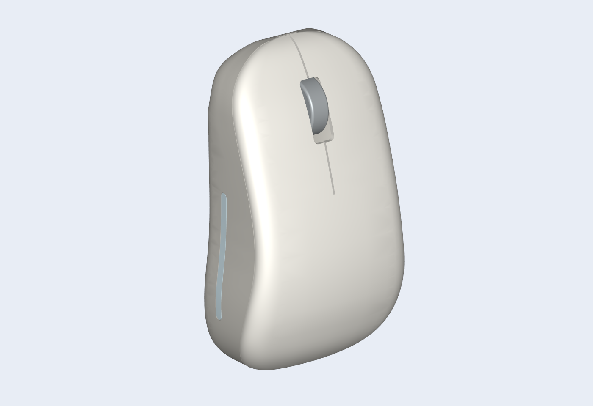
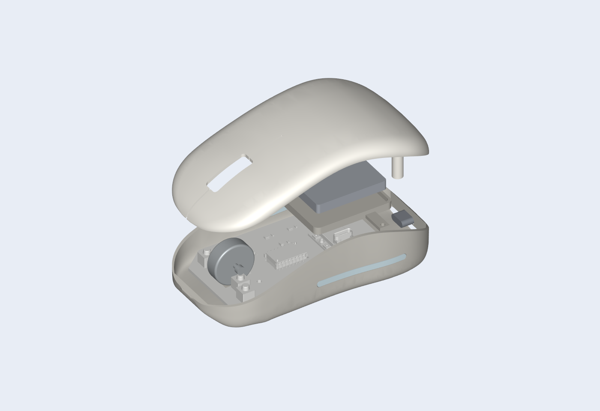
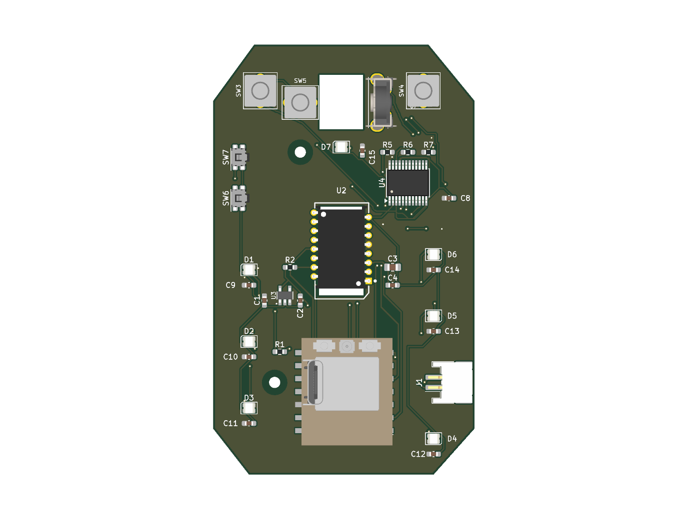
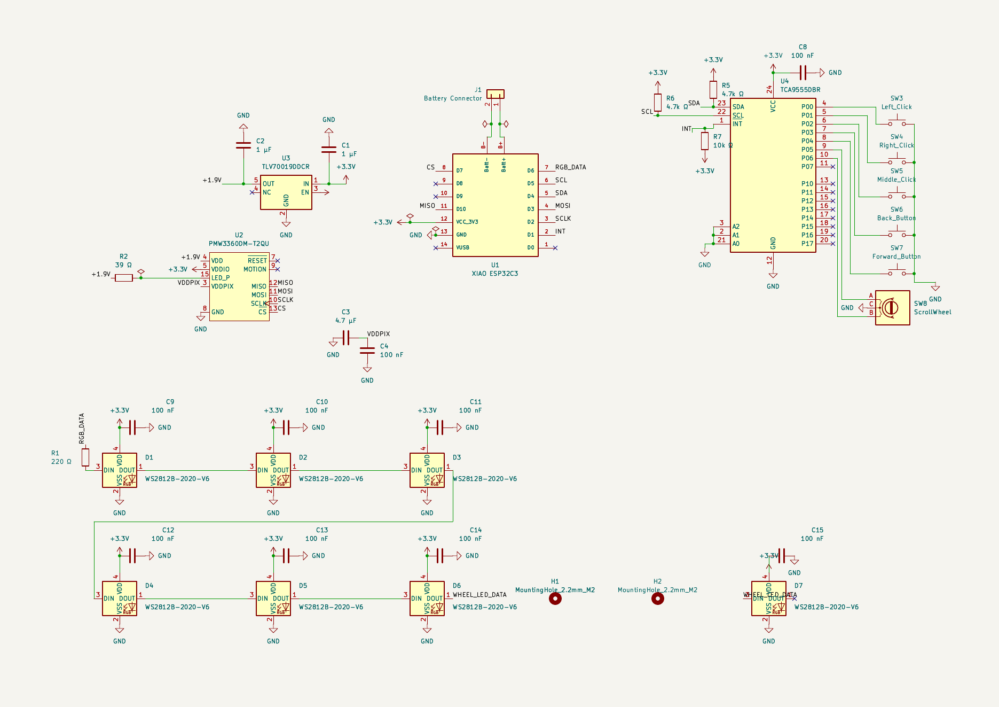

# Mouse

A custom Bluetooth mouse with a printed case, a PMW3360 optical sensor, and RGB lighting. The shape is based on the Lenovo Yoga Bluetooth Silent Mouse, with a rounded back for a comfortable palm grip.



## Why I made it

My current mouse feels a bit small, and I really liked the shape and click feel of a Lenovo Yoga mouse I used before. I wanted to make my own mouse with that kind of comfort, while learning how to put the PCB, firmware, and case together. I also wanted RGB lighting with diffusers built into the sides.

## The design

- Seeed XIAO ESP32-C3 for Bluetooth and battery charging
- PMW3360 sensor with an LM19-LSI lens
- Left click, right click, and a clickable scroll wheel
- Seven addressable RGB LEDs, including one near the wheel
- A printed top cover, base, wheel, battery tray, and two translucent side diffusers
- A rear USB-C opening and adhesive PTFE skates

The mouse sends input over Bluetooth. USB is used for charging and flashing the firmware.

## CAD assembly

The exploded view shows the case, PCB, battery envelope, and removable tray. The battery and rear USB-C connector in the model are references for checking the layout.



The assembly STEP file is in `cad/mouse.step`. The Onshape document also has views of the PCB, the assembled mouse, and the individual case parts. [Open the Onshape assembly](https://cad.onshape.com/documents/f339b248a5d93d00b356f41b/w/cae739c57158e79859cbe66f/e/194018f47ffd620b1df57684).

## PCB

The PCB carries the controller, sensor, switches, scroll encoder, battery connector, and LEDs.



## Schematic



## Files

| Folder | Contents |
| --- | --- |
| `production/firmware` | Compiled firmware for the XIAO ESP32-C3 |
| `production/print` | STL files for the case, wheel, tray, and diffusers |
| `production/gerbers.zip` | Copper, mask, silkscreen, outline, and drill files |
| `PCB` | KiCad project, schematic, PCB, custom footprints, and component models |
| `code` | Arduino source and the sensor SROM header |
| `cad` | Full assembly STEP file and skate patterns |

## Firmware and use

I edit the firmware in IntelliJ IDEA and build it with Arduino CLI. It handles Bluetooth mouse reports, the three buttons, scroll input, RGB lighting, and the PMW3360 sensor.

With Arduino CLI installed, run these from the repository folder to install the board support and libraries, then compile.

```powershell
arduino-cli config add board_manager.additional_urls https://espressif.github.io/arduino-esp32/package_esp32_index.json
arduino-cli core update-index
arduino-cli core install esp32:esp32@3.3.12
arduino-cli lib install "HijelHID_BLEMouse@0.1.0" "NimBLE-Arduino@2.5.2" "Adafruit NeoPixel@1.15.5"
arduino-cli compile --fqbn esp32:esp32:XIAO_ESP32C3 code
```

After uploading the firmware to the assembled mouse, pair with **Seashell Mouse** in the computer's Bluetooth settings. The compiled image in `production/firmware` is a merged flash image for address `0x0`.

The PMW3360 SROM was adapted from the header in [macsboost/pmw3360](https://github.com/macsboost/pmw3360/blob/master/PMW3360_SROM.h).
